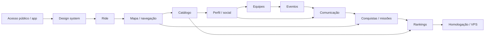

# Apex Ride — plano técnico das 12 partes de refinamento

**Planejamento da Parte 0, 23/10/2026; baseline `c9f40c7`. Nada abaixo foi implementado
por este documento.** A [auditoria](AUDITORIA_LANCAMENTO_APEX_RIDE.md) e seu registro
de 230 requisitos são o inventário de entrada. Estado de lançamento atual: **NO-GO**.

## Regras de execução e preservação

1. Trabalhar uma parte por vez. Registrar o delta frente ao baseline, testes e limites;
   não abrir alterações concorrentes nos mesmos contratos/rotas/migrações.
2. Reutilizar contas, motos, Ride, IndexedDB/sync, social, grupos, eventos, XP e admin.
   Novos nomes de produto não justificam bancos/fluxos duplicados.
3. Preservar Racing Tech e as cinco abas inferiores: Início, Explorar, Ride, Comunidade,
   Garagem. Perfil/rankings/sessões/chats usam páginas internas e navegação contextual.
4. Migrações futuras são aditivas e numeradas quando iniciadas. Não reescrever as 32
   existentes. Planejar backfill, reprocessamento, rollback compatível e preservação
   de dados locais antes de habilitar contratos novos.
5. “Disponível” exige ação principal real, API/autorização/persistência, erros e testes.
   Um componente visual, seed de catálogo ou mensagem de sucesso não basta.
6. Separar critério de produto, limite do navegador e decisão operacional. Nenhuma
   parte promete instrumentação certificada ou coleta contínua em background.
7. Os nomes de tabelas/contratos sugeridos abaixo são **propostas**, não schemas criados.
   Confirmar contratos ao iniciar a respectiva parte e publicar documentação revisada.
8. Aprovação de uma parte não autoriza deploy. P12 prepara implantação; promoção de
   produção exige decisão formal e autorização separada do proprietário.

## Sequência e dependências

P7/P8 especificam canais/eligibilidade de chat, mas a persistência/transporte e a
aceitação ponta a ponta dos três chats pertencem à P9. P8 pode entregar o núcleo de
eventos, mantendo chat explicitamente pendente até essa integração. Não criar botão
cenográfico “funcional” para fechar a parte. O mesmo vale para cartões de perfil
preparados na P6 e inventário de adesivos entregue na P10.

## Parte 1 — Landing page e autenticação

**Entrada:** inventário aceito, mensagens comerciais limitadas a capacidades reais,
rotas públicas/internas e exceções definidas. Referências: A01–A09, QA06, VIS-09/10.

**Reutilizar:** AuthProvider, RequireAuth, API de contas/tokens/sessões e RBAC/MFA.
**Implementar:** landing de apresentação; layout público/auth separado do layout do
aplicativo; login e cadastro independentes, recuperação e retorno seguro; segregação
de acesso às cinco abas internas. Uma proposta é `/` público e `/app/*` autenticado,
com aliases/redirects legados. O contrato definitivo deve ser fechado antes de editar
rotas; isso não altera automaticamente os endpoints públicos autorizados de resumo.

**Integração:** revisar links salvos, compartilhamentos, query de moto/rota/evento,
PWA `start_url`/scope, SW, offline, reload e retorno de login. Não apagar IndexedDB ou
vídeos para trocar o layout. Atualizar textos que descrevem funções reais como futuras;
privacidade deve distinguir preferência de conta e sessão social temporária efetiva.

**Aceite:** visitante vê apresentação; caminhos internos exigem sessão; login/cadastro
não exibem navegação de condução; logout e expiração retiram acesso; retorno não aceita
redirecionamento externo; admin permanece separado e exige permissão/MFA. Resumo público
continua respeitando consentimento, sem GPS bruto. SMTP real depende de staging preparado.

**Testes:** rotas diretas, histórico do navegador, offline/reload, recuperação por token,
CSRF/origem, outra conta e acesso administrativo negativo. Sem redefinir a política
de dados públicos por mera reorganização de frontend.

## Parte 2 — Design system premium

**Entrada:** layouts/rotas estabilizados. Referências: D01–D10 e VIS-03/04/06/07/11.

**Reutilizar:** tokens Racing Tech, tipografia, componentes, cards, ícones autorais e
contratos de acessibilidade. **Implementar:** variantes primária/secundária/destrutiva,
navegação, alternância e estado; escala coerente de campos/selects/labels; espaçamento,
foco, loading/disabled/erro e hierarquia. Não usar vermelho intenso em toda ação.
Revisar os pictogramas rejeitados e distinguir inclinação/força G de uma moto decorativa.

**Dados:** sem migração de domínio prevista para apenas tokens/estilos; isso não é
autorização para trocar o framework ou refazer todos os componentes de uma vez.

**Aceite:** contraste aplicável em todos os estados, incluindo a amostra hover 3,38:1;
alvos e espaçamento usáveis; labels legíveis; ações destrutivas distinguíveis e com
confirmação proporcional. Layouts com texto longo, dados ausentes e erro preservam o
conteúdo. Cotejo com referências originais e aceite visual do proprietário.

**Testes:** capturas mobile/tablet/desktop, teclado/foco, movimento reduzido, leitor de
tela e contraste real. Ausência de overflow não basta. Alterações visuais por módulo
devem ser incrementais, acompanhadas de regressão das funções.

## Parte 3 — Ride, telemetria e organização de sessões

**Entrada:** design system e acesso protegidos. Referências: S*, M*, AS*, T*, H*, RE*,
V*, OV*, N-ST*, VIS-01/02/03/11/12.

**Reutilizar:** único RideProvider/controller, coleta GPS/motion/speed, cálculos
compartilhados, índices/leases, Histórico/Replay, gravação/overlay existentes.
**Implementar:** preparação compacta e opcional, modo de condução com controles
prioritários/estado claro, hub contextual de sessões/circuitos/vídeos/estúdio e estado
global no botão Ride. `aria-current` da aba continua significando página; indicador de
sessão deve comunicar running/paused/waiting por texto/estado próprio, sem depender só
de cor ou animação.

Organizar os dois eixos: Passeio/Pista/Misto para métricas; livre/rota/evento para
contexto. Não trocar os enums persistidos. Diagnósticos de GPS/acelerômetro/giroscópio/
inclinação e calibração devem ser opcionais, feitos com moto parada/suporte seguro.
Indisponibilidade de sensor não bloqueia GPS básico. Não reproduzir instruções do
protótipo que induzam manobras físicas inseguras ou tratem estimativa como certificada.

**Métricas:** definir média em movimento, janela de 100 m, cronômetro/última/melhor/delta
de volta e maior viagem com origem/qualidade. Reutilizar melhor volta histórica já
existente. Habilitar inclinação dinâmica somente após protocolo de validação com erro
conhecido; caso contrário manter indisponível, sem zeros ilustrativos. Circuitos devem
ter geometria/sentido/linha de largada verificados. Se novos dados derivados exigirem
persistência, preservar o GPS original e versionar o cálculo.

**Vídeo:** manter chunks/segmentos/original; reorganizar a UI do estúdio. Importação
externa de vídeo é extensão separada com limite de tamanho, MIME/codec real, associação
autorizada e ajuste temporal. Sem prometer MP4/áudio/background em todo aparelho.

**Aceite/testes:** ciclo completo e interrupções, botão global coerente entre páginas,
matemática com resultado independente, pausas/lacunas, modo/contexto, recuperação/offline,
quota, owner diferente, arquivo exportado reproduzível com dados nos frames. Testes
físicos ficam documentados por recurso; nenhuma simulação libera capacidade física.

## Parte 4 — Mapas, rotas, navegação e elevação

**Entrada:** contrato de Ride/contexto e ponto de entrada de Explorar. Referências:
R*, N-R*, SI*, C*, VIS-04/05.

**Reutilizar:** MapLibre, editor/versões de rotas, OSRM adapter, route tracker,
comparações/similaridade e políticas de geometrias privadas. **Implementar:** CTA de
criação junto ao mapa, destino/endereço, planejamento didático, GPX validado, manobras
e recálculo integrado. Não redirecionar ao Waze como implementação da função principal.

**Dependências externas:** escolher geocodificador/roteador/dados com licença,
atribuição, capacidade e privacidade avaliadas. OSRM atual usa `steps=false`; fornecer
instruções exige alterar o contrato/adapter e implementar a máquina de navegação.
Duração planejada não é trânsito em tempo real ou ETA sempre válido. Sem fonte
legítima, trânsito/alertas permanecem indisponíveis e fora das promessas.

**GPX:** parser com limite de arquivo/pontos, proteção contra XML perigoso, validação
de coordenadas/tempos, tratamento de gaps e duplicatas. Arquivo sem tempo pode virar
plano; com tempo exige revisão para sessão importada e origem identificada. Não dar
XP automático a um arquivo só por ser GPX.

**Elevação:** identificar origem/precisão vertical, filtrar ruído e descontinuidades,
tratar barômetro/DEM como fontes diferentes e manter ausência explícita. Não somar
oscilações brutas. Versionar derivados sem sobrescrever GPS original. DEM/barômetro
só entram após confirmar suporte/licença/fonte, sem dados técnicos inventados.

**Aceite/testes:** endereço ambíguo, sem via, provedor fora, desvio/recálculo sem perder
o Ride gravado, instrução com posição degradada, offline sem tiles, GPX inválido/grande,
altimetria plana ruidosa, subida conhecida, qualidade insuficiente e autorização
negativa de rotas privadas. Filtros de trajetos semelhantes devem usar P2 sem mudar
a proteção dos agregados ou comparar vias paralelas como o mesmo trajeto.

## Parte 5 — Garagem brasileira e fichas técnicas

**Entrada:** taxonomia de categoria e contratos de dados aprovados. Referências:
G*, N-G*, RK04.

**Reutilizar:** moto pessoal manual, seleção/fotos/arquivo histórico e classificação
existente; **não** transformar `motorcycle_model_categories` em suposto catálogo
completo por renomeação. **Implementar:** catálogo consultável por marca/modelo/ano/
versão, ficha técnica com origem/versão/unidade, cobertura explicitamente medida e
processo de atualização/curadoria. Preservar cadastro manual se a moto não existir.

**Dados propostos:** referência técnica separada da moto pessoal; fontes/documentos,
revisões e especificações com possibilidade de “não informado”. Pesquisar fontes
primárias de fabricantes e bases licenciadas antes de escolher ingestão. Uma base de
preços/nomes não garante especificação mecânica, versão comercial ou cobertura total.
Não inferir torque/potência de cilindrada nem copiar material sem direito de uso.

**Campos:** motor, cilindrada, potência, torque, transmissão, tanque, peso com tipo,
freios, pneus, suspensões, assento, arrefecimento, combustível e outros comprovados.
Modelo/ano/versão selecionados precisam manter snapshot/referência histórica, sem
alterar categorias de atividades antigas silenciosamente.

**Aceite/testes:** matriz de cobertura e procedência, versões realmente distintas,
unidades, valores ausentes, atualização sem perda de customizações, moto desconhecida,
permissões de edição/curadoria, foto privada e efeitos em filtros/rankings. Não anunciar
“100% das motos do Brasil” sem comprovação.

## Parte 6 — Perfis, comunidade e base de momentos

**Entrada:** identidade e taxonomia; P1/P2 estáveis. Referências: SO*, N-P*, N-F*, VIS-09.

**Reutilizar:** feed/posts/fotos/curtidas/comentários, follows/listas, busca, bloqueios,
denúncias e perfil textual. **Implementar:** avatar/capa próprios, interesses,
preferências/estilos, região opcional e cartão pessoal. Exibir listas já existentes
com entrada clara; não criar outra tabela de seguidores. Equipe principal depende da
P7; adesivos do cartão dependem da P10 e não podem ser simulados como obtidos.

**Contratos:** campos públicos/privados explícitos, upload seguro de avatar/capa,
revogação e remoção, DTOs com mínimo necessário. Não transformar o produto em namoro
nem inferir residência/localidade por GPS. Galeria só agrega fotos com autorização
vigente; foto pública em uma função não abre outros dados pessoais.

**Momentos:** definir vínculo de post/contexto com elegibilidade, autor e público;
integração completa de evento entra na P8. O atual `event_id` de mídia/capa não basta.
Download deve ter permissão específica e derivados opcionais; marca d'água não altera
original sem consentimento. Não tratar a impossibilidade de impedir captura de tela
como promessa de controle técnico absoluto sobre uma foto pública.

**Aceite/testes:** duas contas, privado/seguidor/bloqueado, atualização de avatar/capa,
listas paginadas, nome/biografia longa, XSS, remoção e revogação em galeria/resumo.
Nenhum conteúdo demonstrativo aparece como atividade real.

## Parte 7 — Equipes e identidade

**Entrada:** contratos de perfil/mídia e decisão de papéis. Referências: GR*, N-EQ*.

**Reutilizar:** groups/membership/rules/invitations/feed/imagens/eventos existentes.
**Implementar:** apresentação consistente como equipe, emblema/cores/tema, cartão,
biografia se necessária e placa virtual decorativa. Nome, número e identidade são
elementos visuais; não solicitar placa oficial, RENAVAM ou documentos do veículo.

**Papéis:** proposta nominal Criador, Co-líder e Membro. Antes da migração, comparar
permissões de owner/admin/moderator/member e definir preservação de creator_id,
transferência e capacidades de moderação. Não elevar moderadores automaticamente ao
unificar nomes. Não criar cargos redundantes apenas para contornar essa decisão.

**Chat:** especificar vínculo estável de canal com equipe e elegibilidade por membro;
backend/transporte na P9. Não anunciar chat funcional enquanto só houver layout.

**Aceite/testes:** pedido/convite, regras, transferência, suspensão/saída/remoção,
privacidade e imagem por URL direta, contraste de tema e placa sem dados registrais.
Equipe principal desaparece do perfil quando perder o vínculo. Mapeamento de cargos
possui matriz negativa revisada e caminho de recuperação.

## Parte 8 — Eventos avançados, momentos e fotos

**Entrada:** equipes e políticas de mídia/relacionamentos. Referências: EV*, N-EV*, N-F*.

**Reutilizar:** encontro/passeio, fusos/UTC, grupo/convite/público, immediate/approval,
capacidade/RSVP, ponto/rota, organizadores, foto de capa e GPS temporário. **Implementar:**
público de amigos com definição explícita de relação, tema da equipe, momentos/galeria,
recap autorizado, destaque curado, documentos informativos e designs compartilháveis.

**Dados propostos:** vínculo de momento ao evento, definição/consentimento de galeria,
metadados de anexo, política de download/derivados e registro de curadoria. A associação
não torna posts privados públicos. Recap não deve materializar cópias que continuem
acessíveis após a revogação do autor. Conservar original; marca d'água só no derivado
autorizado com nome público do autor e identidade discreta própria.

**Aprovação:** usar o mecanismo existente de entrada automática, respeitando
membership, convite, bloqueios, capacidade e conta. “Ignorar aprovação” não é bypass.
**Documentos:** informar finalidade, validar tipo/tamanho/conteúdo, armazenamento
privado e acesso por elegibilidade; não pedir documentos pessoais sensíveis.
**Chat de evento:** contrato e superfície aqui; entrega operacional na P9.

**Aceite/testes:** evento privado/grupo/amigos, expulsão, revisão de público, fuso,
aprovação automática elegível, anexo perigoso e URL direta, foto revogada em recap,
arte com apenas dados autorizados, cancelamento e revogação de GPS social. Nenhum
streaming de vídeo ao vivo é adicionado por confusão com momentos fotográficos.

## Parte 9 — Comunicação e notificações reais

**Entrada:** identidade, bloqueios e permissões de equipes/eventos. Referências:
N-C*, N-N*, N-EQ06, N-EV10.

**Implementar:** fundação de mensagens persistidas, ordenação/idempotência/paginação,
canais de equipe/evento/local e transporte autenticado de atualização. Decidir entre
WebSocket/SSE/polling após medir o contrato/capacidade; GPS social atual não atende
automaticamente essa finalidade. Esboços possíveis: channels/messages/memberships
derivadas e notifications/read state; confirmar nomes/modelo antes da migração.

**Chat local:** opt-in separado, região aproximada compatível com cerca de 10 km,
sem expor coordenadas exatas, residência ou histórico. Expiração de 12 h baseada no
servidor precisa ser aplicada a listagem, ID direto, eventos do canal, cache e
reconexão; apagar só na UI é insuficiente. Definir política restrita e separada de
retenção mínima de moderação. Não reaproveitar consentimento GPS social como opt-in
de chat ou transmitir posições atrasadas.

**Notificações:** derivar de eventos reais de convite/comentário/seguidor/evento/
conquista/medida administrativa; ligação com transação/outbox para não emitir antes
do commit nem duplicar. Central, leitura/não lida, contador real e deep link que
revalida o conteúdo. Push é opcional e depende do suporte/necessidade; entrada no app
não solicita permissão automaticamente. Mensagens de erro/sucesso atuais continuam
separadas de notificações persistidas.

**Segurança/aceite:** limites de spam, bloqueio, denúncia e moderação por canal;
revogação imediata na autorização após remoção da equipe/evento; reconnect/entrega
atrasada sem acesso antigo; TTL negativo por API; dois dispositivos; itens apagados;
contador zero real; ausência de coordenada exata. UX orientada a uso parado, sem
incentivar digitação ao conduzir. Validar todos os três chats e concluir pendências
de integração das P7/P8 antes de marcar comunicação operacional.

## Parte 10 — Cem conquistas, adesivos e missões

**Entrada:** fatos legítimos de Ride/rotas/catálogo/social/equipes/eventos, notificações
e privacidade estabilizados. Referências: XP*, N-XP*, N-P09/10.

**Reutilizar:** achievement_definitions/user_achievements, XP versionado, ledger,
jobs, progress e compensações. **Implementar:** catálogo de pelo menos 100 conquistas
distintas e operacionais; inventário de adesivos/geofences elegíveis; organização no
cartão; motor de missões diárias/semanais/mensais/anuais com objetivo, prazo, progresso,
recompensa e histórico. As 11 atuais precisam ser revisadas e preservadas quando
válidas; seed de 100 nomes ou critérios dependentes de módulos ausentes não cumpre a meta.

| Categoria sugerida             | Quantidade a validar |
| ------------------------------ | -------------------- |
| Primeiros passos               | 10                   |
| Utilização e telemetria válida | 15                   |
| Rotas e exploração             | 20                   |
| Eventos e participação         | 15                   |
| Equipes                        | 10                   |
| Lugares e colecionáveis        | 15                   |
| Garagem e perfil               | 5                    |
| Circuitos e marcos elegíveis   | 10                   |
| Total                          | 100                  |

Para cada item: ID único, nome/descrição, categoria, ícone próprio, critério explícito,
fonte/fato, progresso, versão, estado, desbloqueio idempotente e teste de reversão.
O catálogo editorial pode propor itens futuros, mas eles devem ficar indisponíveis
e não contar como 100 conquistas funcionais até o critério existir.

**Colecionáveis:** destino/geometria apropriados, consentimento separado, prova mínima
privada, não duplicação e tratamento de spoofing/inconclusivo. Não publicar a visita
ou exigir GPS social; não criar incentivo a área restrita ou risco. Eventos/equipes
podem conceder itens por participação legítima sem expor trajeto.

**Missões:** fuso/período/relógio do servidor explícitos, sem efeitos retroativos
silenciosos. Atividades offline só pontuam após validação. Incluir ações sem
deslocamento, como organizar Garagem, revisar histórico, planejar rota e personalizar;
sem penalizar descanso, exigir pilotagem diária ou premiar velocidade/G/inclinação.

**Aceite/testes:** 100 critérios reais auditados individualmente, progresso e
persistência; concessão/reversão única; reset de período; privacidade de visita;
notificação correspondente; atividade excluída; fraude/qualidade insuficiente;
cartão apenas com itens próprios. Nenhuma nova regra altera o ledger antigo por UPDATE.

## Parte 11 — Rankings voluntários e temporadas

**Entrada:** fatos/regras da P10 e catálogo/classificações da P5. Referências: RK*,
N-ST*, C02 e políticas de agregados.

**Reutilizar:** opt-in, seasons/scores/participation, queries e filtros existentes.
Geral, XP, participação e exploração já têm base real; não recriar o livro-razão.
**Implementar/estender:** tipos de missões, conquistas e quilometragem elegível,
definição de alcance vitalício versus sazonal, apresentação clara e filtros por
estado/região/categoria/cilindrada. O geral sem filtro regional já não possui mínimo
artificial: testar o caso exato de um participante elegível, sem fabricar concorrentes.

A consulta atual exige score positivo; opt-in com zero XP não garante uma linha no
placar. Definir a apresentação desse caso (pontuação zero ou estado sem atividade
elegível) e testá-la explicitamente, sem impor quórum ou inventar concorrentes.

**Privacidade:** resolver explicitamente a política regional atual de cinco contas
frente à nova experiência. Não remover o limite dos agregados de comparação/
similaridade (dez contas) para atender o ranking geral: finalidades/modelos são
diferentes. Região permanece declarada, nunca deduzida de residência via GPS.

**Métricas pessoais:** máxima/média/distância já existem com qualidade; maior viagem
precisa definição/eligibilidade se virar destaque. Inclinação máxima segue indisponível
sem estimador validado. Classificações competitivas de tempo/velocidade/inclinação
somente em circuito fechado verificado, sentido/versão compatíveis, qualidade técnica
e opt-in. A API atual mantém resultados de circuito pessoais e classificação pública
desligada; não basta mudar um booleano para alegar homologação.

**Aceite/testes:** opt-in/out, uma conta, empate/ordenação/paginação, região sem dados,
sem categoria, temporada encerrada/fronteira de mês, concessão offline duplicada,
atividade excluída, sanção/reversão e privacidade após revogar. Nenhuma velocidade em
rua concede XP ou posição competitiva. Resultados smartphone continuam identificados
como estimados, sem equivalência a cronometragem certificada.

## Parte 12 — Homologação, operação e preparação da VPS

**Entrada:** partes anteriores com evidência e pendências explicitadas, sem P0/P1
impeditivo escondido. Referências: QA*, AD04, N-VPS*, relatório da Parte 23.

**Integração:** executar jornadas de conta/Garagem/Ride/offline/Replay/rotas/comparação/
vídeo/social/equipe/evento/chat/notificação/conquista/missão/ranking/moderação e
revogações. Proteger migrações, bases IndexedDB antigas, assets de versões anteriores,
filas e dados existentes. Rever contraste, leitores de tela, foco, teclado virtual,
safe areas e aprovação visual em layouts reais.

**Hardware:** Android intermediário/superior e iPhone Safari/PWA quando disponíveis,
registrando versões e resultados. GPS/sensores/câmeras, bloqueio/troca de app/chamada,
quota, períodos longos, export/áudio/codecs, rede e bateria. Simulação continua sendo
simulação. Não realizar testes de pilotagem perigosos em via pública.

**Segurança/performance:** matriz de autorização de todos os módulos novos, abuso/
uploads/expiração/reconnect e revisão independente proporcional. Medir Ride/feed/
mapas/vídeo e banco com volume representativo em staging; orçamentos/SLO claros, sem
inferir milhares de usuários de um teste local pequeno. SMTP, mapas/geocodificação/
roteamento e fontes do catálogo precisam estar legitimamente operacionais.

**VPS:** primeiro obter inventário autorizado do host e do outro sistema. Definir
usuários/processos/bancos/roles/arquivos/logs/segredos/volumes/backups independentes,
limites de recurso e portas internas livres comprovadas, proxy compartilhado seguro,
domínio/HTTPS e renovação. Validar config/reload sem reiniciar tudo e testar ambos os
sistemas. Não presumir domínios/portas já existentes nem tocar no outro projeto.

**Recuperação:** backup externo criptografado, retenção/acesso, RPO/RTO aceitos,
restauração de banco+mídias/roles/config conforme escopo, revogação de sessões
conforme incidente e rollback compatível com schema. Ensaiar em ambiente separado;
restaurar sobre produção para testar é proibido. Monitoramento/alertas/responsáveis,
contatos de suporte/moderação e políticas jurídicas/operacionais finais precisam de
aceite próprio. Licença do código não substitui termos/privacidade do serviço.

**Saída:** relatório por requisito/jornada/aparelho, defeitos classificados, evidências
sanitizadas e decisão GO/CONDITIONAL GO/NO-GO/INSUFICIENTE EVIDÊNCIA fundamentada.
**Preparar implantação não autoriza executá-la.** Só publicar após autorização
explícita, com procedimento concreto aprovado, backup/rollback e observação inicial.

## Critérios comuns de saída de cada parte

- Rotas/API/schema/contratos documentados e integrados aos módulos existentes.
- Ação principal funciona com dados persistidos; estados vazio/erro/negado/offline
  são verdadeiros e não usam sucesso fictício ou conteúdo demonstrativo de produção.
- Regressões relevantes passam; testes novos verificam comportamento e negativos
  críticos, sem retirar assertions ou aumentar limites para esconder falhas.
- Privacidade por finalidade, revogação e permissões entre contas verificadas.
- Design mantém cinco abas, hierarquia/contraste/foco e comportamento mobile.
- Limitações externas/físicas e pendências ficam registradas, com responsável/decisão
  ainda a designar pelo proprietário, sem inventar aceites ou datas.
- Entrega revisada antes de iniciar a próxima parte. A Parte 0 termina neste plano;
  não cria automaticamente landing, módulos novos, migrações ou configuração da VPS.
